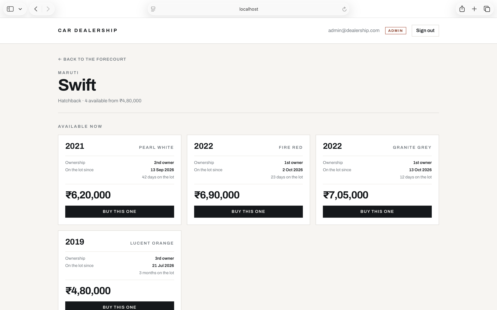

# Car Dealership Inventory System

[](https://github.com/sanianixon/Car_Dealership_Inventory/actions/workflows/ci.yml)

A full-stack vehicle inventory system: a token-authenticated REST API over a real
database, and a React single-page app for browsing, searching and buying stock.

Built test-first for the Incubyte TDD kata. **143 tests — 95 on the backend at
99% statement coverage, 48 on the frontend** — and a commit history of 9 RED /
9 GREEN / 2 refactor steps that shows how the code actually got here.

---

## Contents

- [What it does](#what-it-does)
- [Stack](#stack)
- [Running it locally](#running-it-locally)
- [Running the tests](#running-the-tests)
- [Screenshots](#screenshots)
- [Architecture](#architecture)
- [API reference](#api-reference)
- [Design decisions](#design-decisions)
- [What the tests cover](#what-the-tests-cover)
- [Known limitations](#known-limitations)
- [My AI Usage](#my-ai-usage)

---

## What it does

- Register and sign in; every vehicle and inventory route requires a valid JWT.
- Browse the catalogue of models, sold out or not, ordered by make then model.
  Each card advertises the cheapest car available, the colours on the lot and
  how many are left.
- Open a model to see **the actual cars** behind it — each with its own build
  year, colour, owner count, arrival date and price — and buy a specific one.
- Search by make, model, category and price range, combined with AND. A price
  filter matches against the cars themselves, so it only finds models with a
  car in range still for sale.
- **A car is sold exactly once, even when several buyers reach it at the same
  instant** — see [Design decisions](#design-decisions).
- Administrators can list models, edit them, take more cars in and delete.
  Ordinary users cannot, and are refused by the API, not merely by a hidden
  button.

## Stack

| Layer | Choice |
| --- | --- |
| API | Python 3.11, FastAPI 0.162, SQLAlchemy 2.1 |
| Database | SQLite file (a real database on disk, not in-memory) |
| Auth | JWT (PyJWT, HS256) with bcrypt password hashing |
| Frontend | React 19, TypeScript, Vite 7, Tailwind CSS v4, React Router 7 |
| Backend tests | pytest 9.1 + pytest-cov — 95 tests, 99% coverage |
| Frontend tests | Vitest 3.2 + Testing Library + jsdom — 48 tests |

## Running it locally

Verified by cloning this repository fresh and following these steps.

### Prerequisites

- **Python 3.11 or newer.** Check with `python3 --version`. On 3.9 or 3.10 the
  install fails with a confusing message about `annotated-types`, because the
  pinned dependencies have no build for those versions, and the code uses
  `X | None` annotations at runtime. If your `python3` is older, use an explicit
  interpreter below (`python3.11 -m venv venv`).
- **Node 20 or newer.** Check with `node --version`.

### 1. Backend

```bash
cd backend
python3 -m venv venv              # or: python3.11 -m venv venv
source venv/bin/activate          # Windows: venv\Scripts\activate
pip install -r requirements.txt
```

Seed an administrator and a starter catalogue (safe to run more than once):

```bash
python scripts/seed.py
```

That creates `admin@dealership.com` / `Admin#12345`, plus 14 vehicles — two of
them deliberately out of stock, so the disabled Purchase button is visible
straight away.

Start the API:

```bash
uvicorn app.main:app --reload --port 8000
```

Interactive API docs: <http://localhost:8000/docs>

### 2. Frontend

In a second terminal:

```bash
cd frontend
npm install
npm run dev
```

Open <http://localhost:5173>. The dev server proxies `/api` to port 8000, so
there is no CORS setup and no base URL to configure. If your backend runs
elsewhere, set `VITE_API_TARGET`.

### Configuration

Every variable has a working default for local development.

| Variable | Default | Notes |
| --- | --- | --- |
| `DATABASE_URL` | `sqlite:///./dealership.db` | Any SQLAlchemy URL |
| `JWT_SECRET` | a development key | **Required** when `APP_ENV=production`; the app refuses to start on the default |
| `APP_ENV` | `development` | Set to `production` to enforce the above |
| `ADMIN_SIGNUP_CODE` | unset | When set, registering with a matching `adminCode` grants admin. While unset, every code is rejected |
| `VITE_API_TARGET` | `http://localhost:8000` | Backend the dev server proxies to |

## Running the tests

Backend:

```bash
cd backend
source venv/bin/activate
pytest -v                                      # 95 tests
pytest --cov=app --cov-report=term-missing     # coverage
```

Frontend:

```bash
cd frontend
npm test                                       # 48 tests
npm run test:coverage                          # coverage
```

Both run on every push — see
[`.github/workflows/ci.yml`](.github/workflows/ci.yml). The committed output of
the backend command is in [`docs/test-report.txt`](docs/test-report.txt).

```
95 passed
TOTAL   551 statements   6 missed   99% coverage
```

The six uncovered statements are the `get_db` request dependency and the
start-up lifespan hook, both replaced by the test fixtures. Testing them would
assert on the test setup rather than on the application, so they are left alone
deliberately rather than padded with hollow tests.

## Screenshots

| | |
| --- | --- |
|  |  |
| **Sign in** — register and login share one card | **Dashboard** — the catalogue, ordered by make |
|  |  |
| **Search** — filters combine with AND | **Sold out** — Purchase is disabled at zero stock |
|  |  |
| **A model's own page** — the actual cars, each bought on its own | **Coverage** — backend, 95 tests at 99% |

## Architecture

```
HTTP  ─▶  routers/        request and response shapes, status codes
          services/       business rules, raises domain errors
          repositories/   all SQL; the only layer that holds a Session
          models.py       listings, cars, and database constraints
```

Each layer only knows the one beneath it:

- **Routers** translate HTTP to calls and back. They never build a query.
- **Services** own the rules. They raise `VehicleNotFoundError` or
  `OutOfStockError` and never mention a status code, so they are usable outside
  a web request — which is exactly what [`scripts/seed.py`](backend/scripts/seed.py)
  does, driving `VehicleService` directly with no HTTP involved.
- **Repositories** own the SQL. Changing the storage engine means rewriting one
  class and nothing above it.
- **`errors.py`** maps every failure — raised `HTTPException`, request
  validation, and domain errors — onto one response shape, so no route formats
  an error itself.

Dependencies are assembled per request in [`deps.py`](backend/app/deps.py), so
routes depend on a service rather than on a database session and a test can
replace either one.

## API reference

All paths are under `/api`. Every route except register and login needs
`Authorization: Bearer <token>`.

| Method | Path | Access | Body | Success |
| --- | --- | --- | --- | --- |
| POST | `/auth/register` | public | `{email, password, adminCode?}` | `201 {user}` |
| POST | `/auth/login` | public | `{email, password}` | `200 {token, user}` |
| GET | `/auth/me` | user | | `200 {user}` |
| GET | `/vehicles` | user | | `200 {vehicles}` |
| GET | `/vehicles/search` | user | query: `make, model, category, minPrice, maxPrice` | `200 {vehicles}` |
| GET | `/vehicles/{id}` | user | | `200 {vehicle}` **with its cars** |
| POST | `/vehicles` | **admin** | `{make, model, category, units: [car, …]}` | `201 {vehicle}` |
| PUT | `/vehicles/{id}` | **admin** | any subset of make/model/category | `200 {vehicle}` |
| DELETE | `/vehicles/{id}` | **admin** | | `204` |
| POST | `/vehicles/{id}/purchase` | user | `{unitId?}` | `200 {vehicle, unit}` |
| POST | `/vehicles/{id}/restock` | **admin** | `{units: [car, …]}` | `200 {vehicle, restocked, units}` |

The catalogue has two levels, because a dealership's stock has two levels. A
**listing** is a model; its price and stock are derived from the cars it holds:

```json
{ "id": "…", "make": "Maruti", "model": "Swift", "category": "Hatchback",
  "price": 480000.0,
  "quantity": 4,
  "colours": ["Fire Red", "Granite Grey", "Lucent Orange", "Pearl White"],
  "createdAt": "…", "updatedAt": "…" }
```

`price` is the **cheapest car currently available** — the figure a forecourt
advertises — and `quantity` is how many are left. Neither is stored, so a card
can never advertise stock the lot has already sold.

A **car** is one physical vehicle, returned by `GET /api/vehicles/{id}`:

```json
{ "id": "…", "year": 2019, "colour": "Lucent Orange", "price": 480000.0,
  "ownershipNumber": 3, "acquiredOn": "2026-07-21", "isAvailable": true }
```

`ownershipNumber` counts owners the way Indian used-car listings do, where 1 is
the first owner. `acquiredOn` is the day the dealership took that car in, and
cannot be in the future. `year` accepts next year, because new models reach a
forecourt before their model year starts.

Errors always use one shape, so the frontend has a single thing to parse:

```json
{ "error": { "message": "Validation failed",
             "details": [{ "path": "price", "message": "cannot be negative" }] } }
```

| Status | Meaning |
| --- | --- |
| 400 | Validation failed (`details` names each bad field) |
| 401 | Missing, invalid or expired token; bad credentials |
| 403 | Authenticated but not an administrator |
| 404 | No such vehicle |
| 409 | Duplicate email, or not enough stock |

## Design decisions

The choices worth defending are written up in
**[`docs/DESIGN.md`](docs/DESIGN.md)**. In short:

- **A listing is not a car.** The catalogue is two levels — a model, and the
  individual cars behind it, each with its own year, colour, owner count and
  price. A listing's price and stock are derived from its cars, never stored.
- **A car is sold exactly once**, enforced by a single guarded `UPDATE` rather
  than a read-then-write, and verified by removing the guard and watching the
  tests catch it.
- **Changing the catalogue is admin-only throughout**, because a permission
  enforced only in the interface is not a permission.
- Plus: why search escapes `LIKE` wildcards, why login failures are
  indistinguishable from one another, and why sold-out models stay listed.

## What the tests cover

| File | Tests | Focus |
| --- | --- | --- |
| `test_vehicles.py` | 22 | Listing CRUD, validation, admin-only create/edit/delete |
| `test_inventory.py` | 14 | Buying a named or cheapest car; restocking |
| `test_search.py` | 13 | Filters, price bounds, LIKE escaping, injection |
| `test_vehicle_details.py` | 13 | Per-car history, and stock/price derived from it |
| `test_auth.py` | 8 | Registration, duplicates, login, JWT claims |
| `test_current_user.py` | 8 | Token identity, admin invite code |
| `test_edge_cases.py` | 7 | Paths that only run when something is wrong |
| `test_errors.py` | 3 | The uniform error envelope |
| `test_seed.py` | 4 | The seed script is idempotent and its cars genuinely differ |
| `test_concurrency.py` | 3 | Selling one car twice, under real contention |

Every backend test gets its own temporary SQLite file, so no test can leak state
into another.

On the frontend:

| File | Tests | Focus |
| --- | --- | --- |
| `VehicleCard.test.tsx` | 13 | Purchase disabled at zero stock, from-price, stock wording, admin controls hidden from buyers |
| `format.test.ts` | 11 | Indian digit grouping, dates that do not shift timezone, time on the lot |
| `api.test.ts` | 10 | Bearer token, error envelope to `ApiError`, blank filters dropped, 204 handling |
| `AuthScreen.test.tsx` | 7 | Server messages surfaced, field errors beside their field, admin code handling |
| `SearchBar.test.tsx` | 7 | Filters preserved per keystroke, whitespace treated as unfiltered |

The disabled-button test was checked by removing the `soldOut` guard from the
component and confirming three tests failed, rather than trusting a green run.
That mattered: without the guard the button still *looked* sold out — greyed,
muted, with an explanatory tooltip — and clicking it bought a car with no stock.
A screenshot would have looked entirely correct.

## Known limitations

Stated rather than hidden; each is a deliberate trade for a kata-sized project.

- **Frontend test coverage is narrower than the backend's.** The card, the API
  client and the forms are tested; `Dashboard.tsx`, which orchestrates loading,
  searching and the write operations, is covered only by TypeScript, ESLint and
  manual checking. It is the component most worth testing next.
- **No end-to-end tests.** Backend and frontend are each tested in isolation.
  The two were checked against each other by hand and with a scripted pass over
  the live API, not by an automated browser test.
- **The token lives in `localStorage`**, so any XSS on the origin can read it.
  An httpOnly cookie with CSRF protection would be the production answer.
- **Prices are floats.** Fine here; production money should be integer minor
  units — paise, in this case.
- **A sold car is kept, not deleted.** `sold_at` is stamped rather than the row
  removed, which keeps the history and is what makes a car claimable exactly
  once. The model page shows them under "Recently sold".
- **No per-car editing.** An administrator can list a model, take cars in and
  delete a listing, but cannot correct a typo in one car's colour without
  removing it. The endpoint is a small addition; it simply is not there yet.
- **No refresh tokens, rate limiting or account lockout.** A token simply
  expires after 8 hours.
- **SQLite** suits a single-process kata. The purchase guard is plain SQL and
  works the same on PostgreSQL, but SQLite serialises writers.

## My AI Usage

**Tool used:** Claude (Opus 5) via Claude Code, the terminal CLI, in VS Code.
There were three sessions: planning on claude.ai, a context-review session, and
the implementation.

**How I worked.** I built this with Claude Code as a pair. I set the direction
step by step — what to build next, what the test should assert, what the design
had to be — reviewed what came back, ran the suite at every step, and committed
each one myself. Claude produced most of the implementation against that
direction: the FastAPI application, the tests, the seed script and the React
frontend, one red/green cycle at a time. The brief asks for transparency, so
that is stated plainly rather than softened.

What that leaves out is the part that decided what the code *is*. The
architecture, the data model, the security posture and the interface were my
calls, and several of them reversed what the AI had produced.

**The decisions I made, and why.**

- **A listing is not a car.** The first version followed the brief literally: a
  vehicle row with a `quantity`. When provenance fields were added it put a
  build year, a colour and an owner count on that row, and the dashboard then
  showed four Honda Citys all built in the same year, the same colour, with the
  same owner. I stopped the work and said that made no sense — four cars on a
  forecourt are four different cars. That became the two-level model this
  project now runs on, and it is the change I would most want to talk about.
  It also meant accepting a deliberate divergence from the brief, which I
  decided was worth it and documented rather than hid.
- **Inventory management is admin-only throughout.** `POST` and `PUT` were left
  open to any signed-in user on a literal reading of the brief. I judged that
  wrong: the UI already hid those controls from buyers, so the only thing
  stopping a buyer adding stock was a hidden button. Tightening it broke 35
  tests, which turned out to be worth knowing.
- **The interface was generic.** The first version worked and looked like every
  other generated dashboard — centred card, rounded corners, teal accent. I
  said so, chose the direction for the redesign, and reviewed each pass.
- **Scope.** A thoroughly tested backend over a broad shallow one; how far to
  take the frontend; when to stop adding features.
- **Verification.** Claude has no browser, so every judgement about whether the
  application actually worked was mine: I drove it by hand, took the
  screenshots, and more than once sent back something that was wrong on screen
  while passing its tests.

**What AI got wrong, and how it surfaced.** This is the part I found most
instructive.

- The first concurrency test was **worthless and looked fine**. It passed, so it
  read as proof the purchase was atomic. Claude proposed checking it by
  substituting a deliberately broken implementation — which passed the test
  unchanged. The cause was `TestClient` serialising requests. The test was
  rewritten to drive the service directly and verified in both directions. A
  green test is not evidence until you have watched it fail.
- Two commits were **silently lost**. Multi-line commit messages pasted into the
  terminal as heredocs broke mid-paste, leaving the shell stuck at a `heredoc>`
  prompt swallowing everything typed after it. I reported "done" twice in good
  faith while nothing had actually run. It was caught by checking `git log`
  rather than trusting the report. We switched to writing messages to a file and
  committing with `git commit -F`.
- Carried-over notes claimed a previous version of this project existed on disk
  to reuse a frontend from. It did not, so the frontend was built from scratch.
- A seeded email of `admin@dealership.test` could not work at all: `.test` is a
  reserved TLD that `email-validator` rejects.

**Reflection.** The useful lesson was not that AI is fast. It is that speed is
the risk: it produces plausible work faster than anyone can review it, and
every bad moment in this project was a green signal that meant nothing — a test
that could not fail, commits that were never made, a type check that checked no
files, a CI step asserting on a print statement. None of those were caught by
reading the code more carefully. They were caught by insisting on evidence:
break the implementation and watch the test catch it, read `git log` instead of
trusting "done", run the API against a real server rather than only the test
client.

The other lesson is about where the work actually is. The code was the cheap
part. Deciding that a listing is not a car, that a permission enforced in the
interface is not a permission, that an interface which merely works is not
finished — none of that came out of a prompt, and none of it would have been
caught by a faster model. That is the part I would bring to a team, and the
part I would want to be asked about.

---
