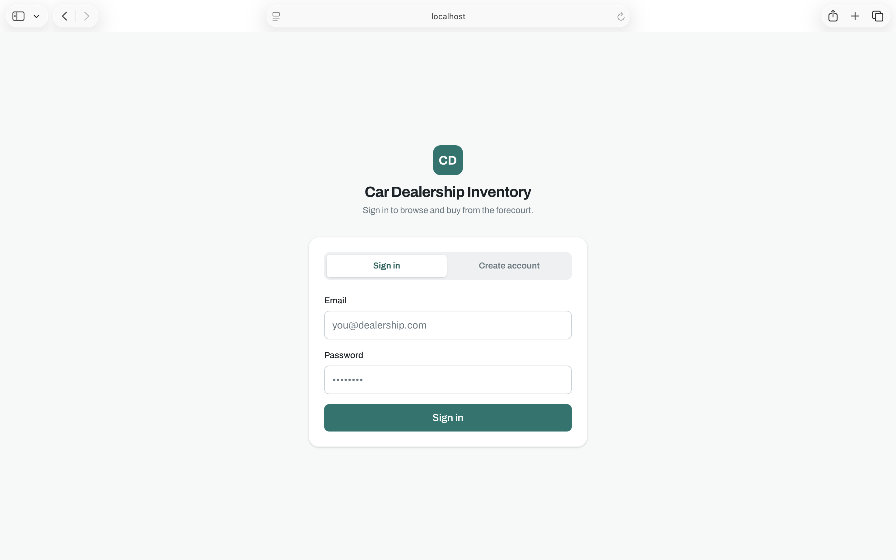
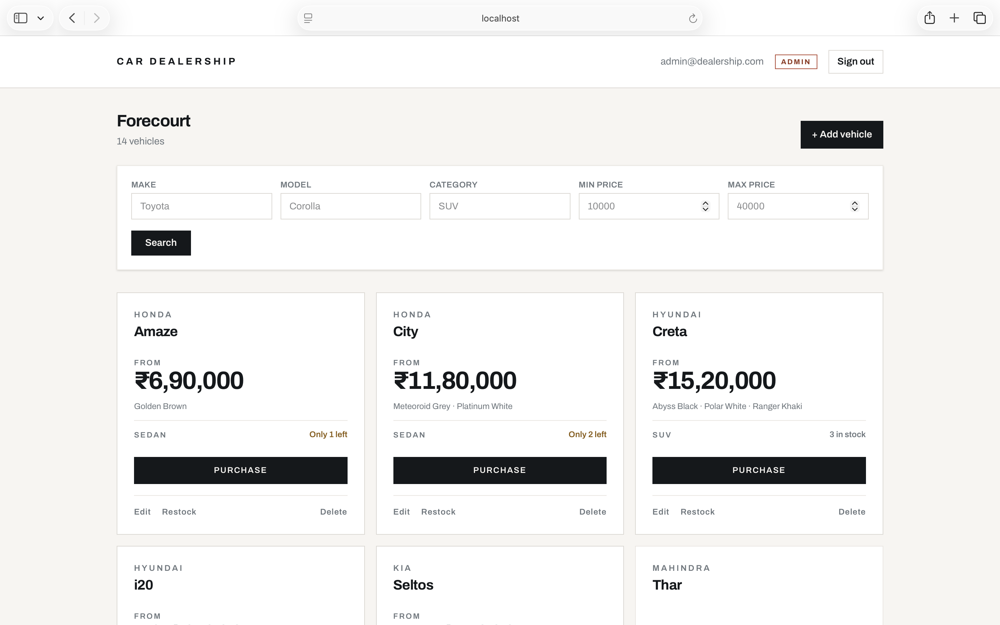
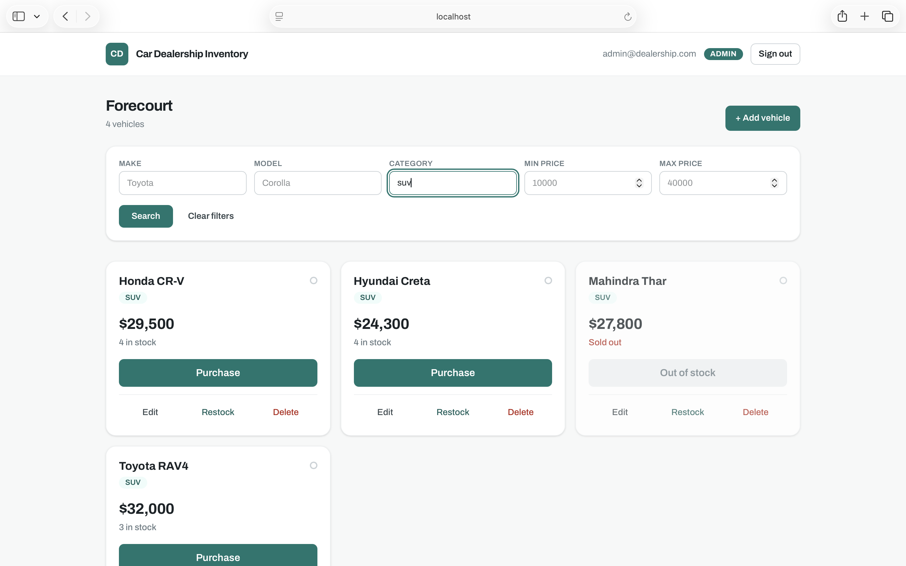
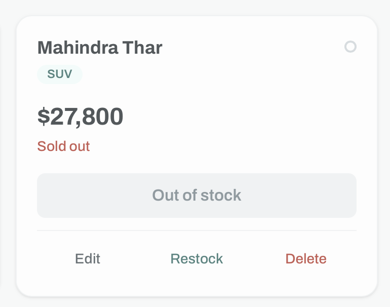
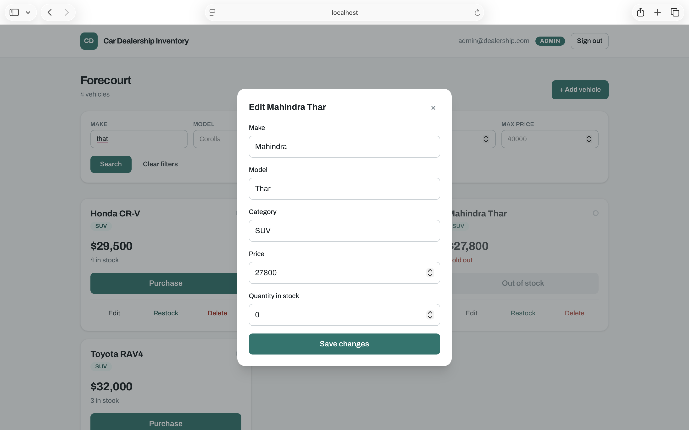
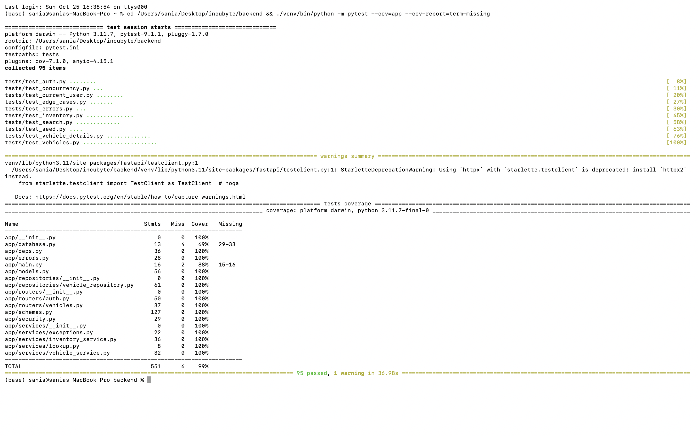

# Car Dealership Inventory System

A full-stack vehicle inventory system: a token-authenticated REST API over a real
database, and a React single-page app for browsing, searching and buying stock.

Built test-first for the Incubyte TDD kata. **74 backend tests, 99% statement
coverage**, and a commit history of 9 RED / 9 GREEN / 2 refactor steps that shows
how the code actually got here.

---

## Contents

- [What it does](#what-it-does)
- [Stack](#stack)
- [Running it locally](#running-it-locally)
- [Running the tests](#running-the-tests)
- [Screenshots](#screenshots)
- [Architecture](#architecture)
- [API reference](#api-reference)
- [Design decisions](#design-decisions)
- [What the tests cover](#what-the-tests-cover)
- [Known limitations](#known-limitations)
- [My AI Usage](#my-ai-usage)

---

## What it does

- Register and sign in; every vehicle and inventory route requires a valid JWT.
- Browse the whole catalogue, including sold-out vehicles, ordered by make then
  model.
- Search by make, model, category and price range, combined with AND.
- Buy a vehicle, which decreases its stock. **Stock can never go negative, even
  when several buyers act at the same instant** — see
  [Design decisions](#design-decisions).
- Administrators can add, edit, delete and restock vehicles. Ordinary users
  cannot, and are refused by the API, not merely by a hidden button.

## Stack

| Layer | Choice |
| --- | --- |
| API | Python 3.11, FastAPI 0.162, SQLAlchemy 2.1 |
| Database | SQLite file (a real database on disk, not in-memory) |
| Auth | JWT (PyJWT, HS256) with bcrypt password hashing |
| Tests | pytest 9.1 + pytest-cov, 74 tests |
| Frontend | React 19, TypeScript, Vite 7, Tailwind CSS v4 |

## Running it locally

Verified from a fresh clone on macOS with Python 3.11.7 and Node 22.14.

### 1. Backend

```bash
cd backend
python3 -m venv venv
source venv/bin/activate          # Windows: venv\Scripts\activate
pip install -r requirements.txt
```

Seed an administrator and a starter catalogue (safe to run more than once):

```bash
python scripts/seed.py
```

That creates `admin@dealership.com` / `Admin#12345`, plus 14 vehicles — two of
them deliberately out of stock, so the disabled Purchase button is visible
straight away.

Start the API:

```bash
uvicorn app.main:app --reload --port 8000
```

Interactive API docs: <http://localhost:8000/docs>

### 2. Frontend

In a second terminal:

```bash
cd frontend
npm install
npm run dev
```

Open <http://localhost:5173>. The dev server proxies `/api` to port 8000, so
there is no CORS setup and no base URL to configure. If your backend runs
elsewhere, set `VITE_API_TARGET`.

### Configuration

Every variable has a working default for local development.

| Variable | Default | Notes |
| --- | --- | --- |
| `DATABASE_URL` | `sqlite:///./dealership.db` | Any SQLAlchemy URL |
| `JWT_SECRET` | a development key | **Required** when `APP_ENV=production`; the app refuses to start on the default |
| `APP_ENV` | `development` | Set to `production` to enforce the above |
| `ADMIN_SIGNUP_CODE` | unset | When set, registering with a matching `adminCode` grants admin. While unset, every code is rejected |
| `VITE_API_TARGET` | `http://localhost:8000` | Backend the dev server proxies to |

## Running the tests

```bash
cd backend
source venv/bin/activate
pytest -v                                      # 74 tests
pytest --cov=app --cov-report=term-missing     # coverage
```

The committed output of that command is in
[`docs/test-report.txt`](docs/test-report.txt).

```
74 passed
TOTAL   449 statements   6 missed   99% coverage
```

The six uncovered statements are the `get_db` request dependency and the
start-up lifespan hook, both replaced by the test fixtures. Testing them would
assert on the test setup rather than on the application, so they are left alone
deliberately rather than padded with hollow tests.

## Screenshots

| | |
| --- | --- |
|  |  |
| **Sign in** — register and login share one card | **Dashboard** — the catalogue, ordered by make |
|  |  |
| **Search** — filters combine with AND | **Sold out** — Purchase is disabled at zero stock |
|  |  |
| **Admin** — add, edit, delete and restock | **Coverage** — 74 tests, 99% |

## Architecture

```
HTTP  ─▶  routers/        request and response shapes, status codes
          services/       business rules, raises domain errors
          repositories/   all SQL; the only layer that holds a Session
          models.py       ORM tables and database constraints
```

Each layer only knows the one beneath it:

- **Routers** translate HTTP to calls and back. They never build a query.
- **Services** own the rules. They raise `VehicleNotFoundError` or
  `OutOfStockError` and never mention a status code, so they are usable outside
  a web request — which is exactly what [`scripts/seed.py`](backend/scripts/seed.py)
  does, driving `VehicleService` directly with no HTTP involved.
- **Repositories** own the SQL. Changing the storage engine means rewriting one
  class and nothing above it.
- **`errors.py`** maps every failure — raised `HTTPException`, request
  validation, and domain errors — onto one response shape, so no route formats
  an error itself.

Dependencies are assembled per request in [`deps.py`](backend/app/deps.py), so
routes depend on a service rather than on a database session and a test can
replace either one.

## API reference

All paths are under `/api`. Every route except register and login needs
`Authorization: Bearer <token>`.

| Method | Path | Access | Body | Success |
| --- | --- | --- | --- | --- |
| POST | `/auth/register` | public | `{email, password, adminCode?}` | `201 {user}` |
| POST | `/auth/login` | public | `{email, password}` | `200 {token, user}` |
| GET | `/auth/me` | user | | `200 {user}` |
| GET | `/vehicles` | user | | `200 {vehicles}` |
| GET | `/vehicles/search` | user | query: `make, model, category, minPrice, maxPrice` | `200 {vehicles}` |
| GET | `/vehicles/{id}` | user | | `200 {vehicle}` |
| POST | `/vehicles` | user | `{make, model, category, price, quantity}` | `201 {vehicle}` |
| PUT | `/vehicles/{id}` | user | any subset of the above | `200 {vehicle}` |
| DELETE | `/vehicles/{id}` | **admin** | | `204` |
| POST | `/vehicles/{id}/purchase` | user | `{quantity?}` (default 1) | `200 {vehicle, purchased}` |
| POST | `/vehicles/{id}/restock` | **admin** | `{quantity}` | `200 {vehicle, restocked}` |

Errors always use one shape, so the frontend has a single thing to parse:

```json
{ "error": { "message": "Validation failed",
             "details": [{ "path": "price", "message": "cannot be negative" }] } }
```

| Status | Meaning |
| --- | --- |
| 400 | Validation failed (`details` names each bad field) |
| 401 | Missing, invalid or expired token; bad credentials |
| 403 | Authenticated but not an administrator |
| 404 | No such vehicle |
| 409 | Duplicate email, or not enough stock |

## Design decisions

### Purchasing is one guarded statement, not read-then-write

The obvious implementation reads the stock, checks it, then writes the new
figure. Under concurrency that oversells: several buyers pass the check before
any of them writes. So the check and the write are a single statement, and the
number of rows it affects is the answer:

```sql
UPDATE vehicles SET quantity = quantity - :n WHERE id = :id AND quantity >= :n
```

Zero rows affected means the guard refused. It can never mean the stock went
negative. Only then is the vehicle re-read, to say whether it is empty or merely
short.

**The test for this is the one I would point at first.** An earlier version of
it passed against a deliberately broken read-then-write implementation, because
FastAPI's `TestClient` drives the app through a single blocking portal and
serialises the requests — so there was never any contention to catch. The real
test in [`test_concurrency.py`](backend/tests/test_concurrency.py) drives the
service directly, each buyer on its own session, all released by a barrier once
every one of them has read the stock. It was then confirmed in both directions:

| Implementation | 10 buyers, 1 in stock | 10 buyers, 3 in stock |
| --- | --- | --- |
| Guarded `UPDATE` | 1 sold | 3 sold |
| Read-then-write | **9 sold** | **10 sold** |

The same class of bug exists in registration, where two requests can both find
an email unused. There the unique index is the real guarantee, so
`IntegrityError` is caught and returned as the same 409 rather than a 500.

### Privilege cannot be requested

`RegisterRequest` has no `role` field at all, so escalation is impossible by
construction rather than by filtering an unwanted value. Admin comes from an
invite code compared with `secrets.compare_digest`, or from the seed script. A
code is accepted only when `ADMIN_SIGNUP_CODE` is both set and matching, so an
unset variable can never be read as "any code works".

`require_admin` reads the role from the database row rather than the token's
claim, so an account that loses admin loses it immediately instead of when its
token expires. For the same reason `get_current_user` looks the subject up on
every request: a correctly signed token whose user has been deleted is rejected.

### Login failures are indistinguishable

An unknown email and a wrong password return byte-identical 401s, so the
endpoint cannot be used to discover which addresses have accounts. When no user
matches, the password is still hashed against a fixed dummy value, because
otherwise the response time alone would leak the answer. `LoginRequest`
deliberately has no password-length rule for the same reason — a 400 would
reveal that the policy, not the credentials, was the problem.

### Search treats input as data

`%` and `_` are wildcards in SQL `LIKE`, so a search for `100%` would otherwise
match everything. They are escaped and the query declares `ESCAPE`. Values are
bound as parameters and never concatenated, which a test asserts by searching
for `'; DROP TABLE vehicles; --` and checking the table survives.

### Other choices worth naming

- **Sold-out vehicles are listed.** "All available vehicles" is read as the
  whole catalogue, because the dashboard needs the sold-out ones in order to
  show a disabled Purchase button at all.
- **`POST` and `PUT /vehicles` are open to any signed-in user.** The brief marks
  only `DELETE` and restock as admin-only, so that literal reading is what the
  API enforces, while the UI shows those controls to administrators only. One
  line in each route would tighten it.
- **Constraints live in the database too.** `CHECK (quantity >= 0)` and
  `CHECK (price >= 0)` back up the request schemas, because validation protects
  the API while constraints protect the data from every other writer.
- **Validation rejects stringified numbers.** `"18500"` for a price is a 400
  rather than a silent coercion, since quietly accepting it hides a caller bug.
- **An empty `PUT` body is a 400.** It almost always means the request was built
  wrongly, and succeeding silently would hide that.
- **No router on the frontend.** There are two states, decided by whether anyone
  is signed in. A routing library would add a dependency without adding
  behaviour.

## What the tests cover

| File | Tests | Focus |
| --- | --- | --- |
| `test_vehicles.py` | 20 | CRUD, validation, admin-only delete |
| `test_inventory.py` | 14 | Purchase and restock rules |
| `test_search.py` | 12 | Filters, price bounds, LIKE escaping, injection |
| `test_auth.py` | 8 | Registration, duplicates, login, JWT claims |
| `test_current_user.py` | 8 | Token identity, admin invite code |
| `test_edge_cases.py` | 7 | Paths that only run when something is wrong |
| `test_errors.py` | 3 | The uniform error envelope |
| `test_concurrency.py` | 2 | Overselling under real contention |

Every test gets its own temporary SQLite file, so no test can leak state into
another.

## Known limitations

Stated rather than hidden; each is a deliberate trade for a kata-sized project.

- **No frontend tests.** The UI is covered by TypeScript, ESLint and manual
  checking only. All 74 tests are backend. The brief emphasises TDD for backend
  logic, and that is where the effort went.
- **The token lives in `localStorage`**, so any XSS on the origin can read it.
  An httpOnly cookie with CSRF protection would be the production answer.
- **Prices are floats.** Fine here; production money should be integer minor
  units.
- **No refresh tokens, rate limiting or account lockout.** A token simply
  expires after 8 hours.
- **SQLite** suits a single-process kata. The purchase guard is plain SQL and
  works the same on PostgreSQL, but SQLite serialises writers.

## My AI Usage

**Tool used:** Claude (Opus 5) via Claude Code, the terminal CLI, in VS Code.
There were three sessions: planning on claude.ai, a context-review session, and
the implementation. All three are reproduced verbatim in
[`PROMPTS.md`](PROMPTS.md), which is generated from the raw session
transcripts by [`docs/make_prompts.py`](docs/make_prompts.py). That script is
committed deliberately: it means "unedited" is checkable rather than merely
claimed, since anyone can re-run it and compare.

**How it was used — accurately.** Claude wrote the great majority of the code in
this repository: the FastAPI application, the test suite, the seed script and the
whole React frontend. It worked one red/green step at a time, and I ran the tests
and made every commit myself.

**What I did.** I set the direction and made the decisions: the stack, the
working method, the scope (a thoroughly tested backend over a leaner frontend),
how far to go on the frontend, and how to handle the disclosure questions below.
I reviewed each step before committing it, ran the suite at every step, drove the
application by hand in the browser, and verified the deliverables. Where Claude
proposed something I disagreed with, or produced something that did not hold up,
we changed it.

**What AI got wrong, and how it surfaced.** This is the part I found most
instructive.

- The first concurrency test was **worthless and looked fine**. It passed, so it
  read as proof the purchase was atomic. Claude proposed checking it by
  substituting a deliberately broken implementation — which passed the test
  unchanged. The cause was `TestClient` serialising requests. The test was
  rewritten to drive the service directly and verified in both directions. A
  green test is not evidence until you have watched it fail.
- Two commits were **silently lost**. Multi-line commit messages pasted into the
  terminal as heredocs broke mid-paste, leaving the shell stuck at a `heredoc>`
  prompt swallowing everything typed after it. I reported "done" twice in good
  faith while nothing had actually run. It was caught by checking `git log`
  rather than trusting the report. We switched to writing messages to a file and
  committing with `git commit -F`.
- Carried-over notes claimed a previous version of this project existed on disk
  to reuse a frontend from. It did not, so the frontend was built from scratch.
- A seeded email of `admin@dealership.test` could not work at all: `.test` is a
  reserved TLD that `email-validator` rejects.

**On the commit trailers.** Every commit here was AI-assisted and carries
`Co-Authored-By: Claude Opus 5`, with one exception. Commit `9b0fc26` is missing
its trailer: the message was pasted into the terminal and truncated at exactly
that line, which is also what jammed the shell. Its body still states the AI
involvement in prose. Rather than rewrite already-pushed history over one line, I
chose to record the omission — in commit `ddf5810`, and here.

**Reflection.** AI made this dramatically faster, and the speed was the risk
rather than the benefit. It produces plausible work at a rate that outpaces
review, and the two worst moments were both cases of a green signal that meant
nothing: a test that could not fail, and commits that were never made. What
helped was insisting on evidence instead of confirmation — break the
implementation and watch the test catch it, read `git log` instead of trusting
"done", run the API against a real server rather than only the test client. I
would use it the same way again, with the same scepticism about anything that
reports success.

---

## Repository layout

```
backend/
  app/
    main.py            application, error handlers, lifespan
    database.py        engine, session factory, get_db dependency
    models.py          User and Vehicle, with CHECK constraints
    schemas.py         request/response models and shared field types
    security.py        bcrypt hashing, JWT issuing and verification
    deps.py            get_current_user, require_admin, service wiring
    errors.py          the single error envelope
    routers/           auth.py, vehicles.py
    services/          vehicle_service, inventory_service, exceptions, lookup
    repositories/      vehicle_repository (all SQL)
  scripts/seed.py      idempotent admin + starter catalogue
  tests/               74 tests
frontend/
  src/
    api.ts             the only module that calls the API
    auth.tsx           auth provider
    auth-context.ts    context and useAuth hook
    components/        AuthScreen, Dashboard, VehicleCard, SearchBar,
                       VehicleForm, RestockForm, Modal
docs/
  test-report.txt      committed pytest + coverage output
  screenshots/
PROMPTS.md             raw AI conversation logs
```
